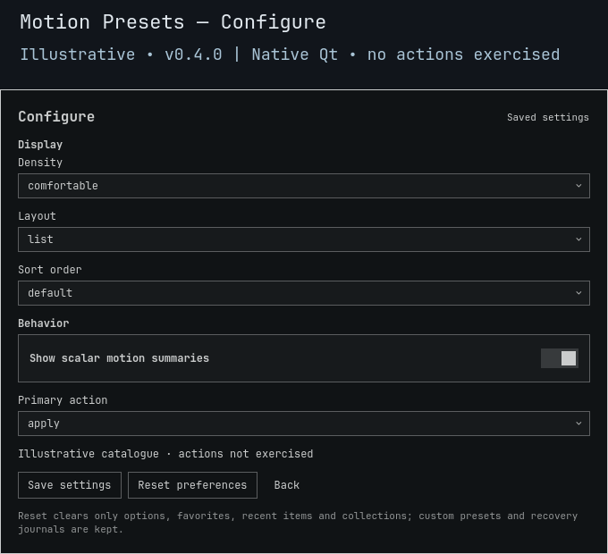

# Motion Presets

**Scalar motion controls, explicit trials, and a recorded way back.**

A native Omarchy panel for disabling animations and choosing workspace wraparound behavior. Changes affect the current compositor session, never startup configuration.

> **v0.4.1 source candidate.** This change does not install or qualify live Apply/Preview/Keep/Restore. The separate full-shell upgrade/rollback gate remains blocked. [Validation history](docs/VALIDATION.md).
>
> **Subtle, snappy, smooth and expressive curve modes, and animation speed, remain unimplemented.** The known API rounds animation reads and cannot exactly undo overrides/inheritance. Scalar toggles are not substitutes. [API limitation](BACKEND.md#motion-specific-scope).


*Illustrative **0.4.0** native Qt component render with fictional/original example data. No installed library, desktop action or full-shell behavior is demonstrated. [Preview provenance](docs/PREVIEW.md).*

<details>
<summary>Preview native saved settings</summary>



*Illustrative Configure view; fields may scroll. The capture does not exercise Save or Reset.*

</details>

## Four scalar choices

| Preset | Animations | Workspace wraparound |
|:---|:---|:---|
| Reduced motion | Disable | Unchanged |
| Direct workspace transitions | Unchanged | Disable |
| Wraparound workspace transitions | Unchanged | Enable |
| Off | Disable | Disable |

Only `animations.enabled` and `animations.workspace_wraparound` are admitted. Bundled presets never enable animations. Captures/imports may remember an enabled state, but Apply/Preview cannot re-enable animations you subsequently disabled. Explicit Restore can return the actual recorded state.

## Select, compare, try

Search and use the arrow keys to select; clicking a row selects without applying. **More** holds secondary actions and capture/import fields.

| Control | Result |
|:---|:---|
| Enter / primary button | Apply by default; choose Preview as the saved primary action in Configure. Only an advertised action is eligible. |
| Apply | Session-only scalar change, without a timer. |
| Compare | Read actual values and display a diff; no setter or journal write. |
| Preview | Start a **15-second** trial with an independent detached watchdog. |
| Keep | Confirm the matching, unexpired trial; retain the original Restore baseline. |
| Restore | Restore the first recorded baseline, even with no search results. |
| Capture | Name and save the current scalar values without changing them. |
| Export preset / Import | Display or paste strict versioned JSON. Import saves inert data; applying is separate. |
| Escape / outside click | Dismiss, not Undo. Escape first leaves Configure; closing does not stop trial recovery. |

## Configure without applying

Choose **Save settings** to persist options. Saving any option, including Preview as primary, calls no compositor setter and never starts a trial.

| Option | Choices; default first |
|:---|:---|
| Primary action (`primaryAction`) | `apply`, `preview` |
| Density (`density`) | `comfortable`, `compact` |
| Layout (`layout`) | `list`, `grid` |
| Sort order (`sortOrder`) | `default`, `name`, `favorites-first` |
| Show scalar summaries (`showDiffs`) | `true`, `false`; catalogue text only |

Favorites, recents and named collections are local. Keep up to **32** named captures/imports; duplicate names are refused, not overwritten. Reset clears preferences and organization, **not** custom presets or recovery journals, and does not restore compositor state.

Preferences and `custom-presets.json` live outside installed source under `${XDG_CONFIG_HOME:-$HOME/.config}/omarchy/lego/motion-presets/`. Recovery lives under `${XDG_STATE_HOME:-$HOME/.local/state}/omarchy-motion-presets/`. [CLI, import format and bounds](BACKEND.md).

## Namespace migration

The plugin ID is now `battlelamb.motion-presets`. Update local menu, binding, enabled-plugin and installed-ID references explicitly; a normal updater cannot implicitly rename a plugin ID. Stable preference, custom-data and recovery paths are unchanged. Complete any pending trial/Restore before replacing the installed runtime; retain its source and journals until recovery finishes.

## Open and manage

Requires Omarchy Quattro, compatible Quickshell/Qt (`qs.Ui`, `qs.Commons`), system Python 3 and **Hyprland Lua 0.56.2**. Other provider versions fail closed. No sibling plugin is required; plugins run unsandboxed inside the shell.

```sh
omarchy plugin add https://github.com/Battlelamb/omarchy-motion-presets --enable
omarchy-shell shell summon battlelamb.motion-presets
# Restore in the panel BEFORE disabling or removing:
omarchy plugin disable battlelamb.motion-presets
omarchy plugin remove battlelamb.motion-presets
```

Install does not apply a preset or add shortcuts. An existing Super+Space → Appearance entry can summon `battlelamb.motion-presets`; preserve existing menu entries if adding one manually.

## Recovery limits and checks

The first actual baseline survives later applications and preference changes. Pending intent is durable before setters; failures attempt compensation to the immediately previous values. Restore/timeout refuse divergent external edits and preserve the receipt. This is value-level conflict detection, not a global compositor lock: same-value **ABA edits remain undetectable**. A watchdog cannot survive logout, missing runtime files or broken IPC indefinitely. Preserve the installed source and journal until recovery completes; Reset and panel dismissal are not recovery.

From a reviewed checkout with an existing private `TMPDIR`:

```sh
TMPDIR="${TMPDIR:?Set an existing private scratch directory}" env -u PYTHONPATH PATH=/usr/bin /usr/bin/python3 scripts/run-tests.py --backend-only
bash test.sh
```

Offline fake-HOME/IPC and native component checks are not live action qualification or hosted CI results. [Preview provenance](docs/PREVIEW.md) records the current illustrative v0.4.0 Browse/Configure captures separately from historical images. These screenshots demonstrate presentation, not desktop actions.

[Backend contract](BACKEND.md) · [Contributing](CONTRIBUTING.md) · [Security](SECURITY.md)

**GPL-3.0-only.** Independent community plugin, not an official Omarchy or HyDE release. Existing donor/source credits remain in [NOTICE.md](NOTICE.md) and [NOTICE.backend.md](NOTICE.backend.md); [full license](LICENSE).
