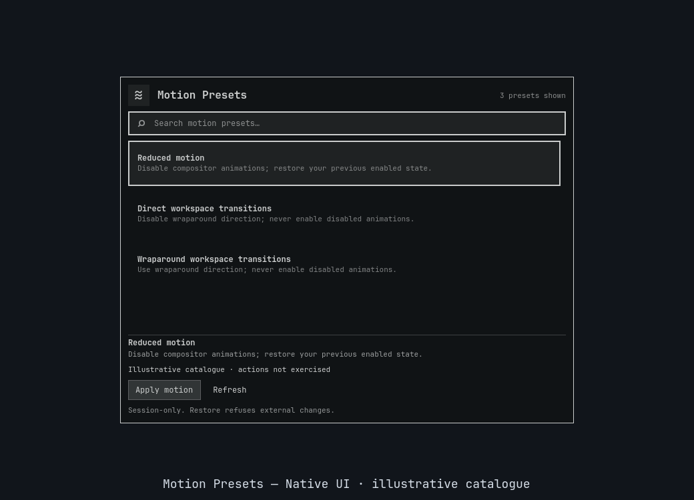

# Motion Presets

**Less motion. Explicit changes. A way back.**

[](https://github.com/Battlelamb/omarchy-motion-presets/actions/workflows/ci.yml)

[Presets](#four-scalar-presets) · [Controls](#choose-compare-preview) · [Install](#install-and-open) · [Settings](#make-it-yours) · [Recovery](#restore-without-overwriting-other-work)

A native Omarchy panel for reducing animations and changing workspace wraparound direction. Compare actual values, try a timed Preview, or save your own scalar settings. Changes affect the current compositor session, not Hyprland's startup configuration.

> [!WARNING]
> **The requested subtle, snappy, smooth and expressive curve modes, plus animation speed, are still missing.** This snapshot implements four scalar presets only. The inspected API cannot exactly snapshot and restore curve precision and inheritance; these controls are not renamed substitutes. [Why this remains incomplete →](BACKEND.md#motion-specific-scope)

> [!NOTE]
> **Development source snapshot · 0.3.0**, not a stable release or tagged build. Live testing verified the new runtime loaded and the populated panel opened, was captured and closed. Live Apply/Preview/Keep/Restore actions are not qualified; the separate full nested upgrade/rollback gate remains blocked.



*Historical 0.2.1 native Qt/Quickshell capture from an isolated headless compositor, using an illustrative catalogue. Actions were not exercised. It shows the earlier three-choice UI, not the current four presets or 0.3.0 controls. [Preview provenance](docs/PREVIEW.md).*

## Four scalar presets

| Preset | Animations | Workspace wraparound |
|:---|:---|:---|
| **Reduced motion** | Disable | Leave unchanged |
| **Direct workspace transitions** | Leave unchanged | Disable |
| **Wraparound workspace transitions** | Leave unchanged | Enable |
| **Off** | Disable | Disable |

Only `animations.enabled` and `animations.workspace_wraparound` are changed. Bundled presets never enable animations. A captured or imported enabled state also cannot re-enable animations you later disabled; **explicit Restore** can return the actual recorded enabled state.

## Choose, compare, preview

Type to search and use the arrow keys to select. Clicking a tile selects it; it does not apply it. Open **More** for secondary actions, capture/import fields, favorites and collections.

| Control | What happens |
|:---|:---|
| **Enter / Apply** | Apply the selected scalar settings for this compositor session. No countdown. |
| **More → Compare** | Read current values and show a before → after diff. No setter or recovery snapshot is written. |
| **More → Preview** | Apply a 15-second trial, with rollback owned by a detached watchdog rather than the panel. |
| **Keep** | Confirm only the matching current, unexpired trial. The original Restore snapshot remains available. |
| **Restore** | Return the first recorded session baseline, not the selected preset's defaults. Works with an empty search result. |
| **More → Capture** | Name and save the current scalar settings without changing them. |
| **More → Export preset / Import** | Copy versioned JSON from the result area or paste it into the action-data field. Import stores data; Apply is a separate step. |
| **Escape / click outside** | Dismiss, not Undo. Escape first backs out of Configure. An active Preview still has its independent watchdog. |

## Install and open

Requires the **Omarchy Quattro shell**, compatible Quickshell/Qt with native `qs.Ui` and `qs.Commons`, system Python 3 and `hyprctl`. The provider adapter is restricted to **Hyprland Lua 0.56.2**; other versions fail closed. No sibling plugin or shared installed framework is required.

Plugins run unsandboxed inside the shell. Review source and the limits above before installing this development snapshot:

```sh
omarchy plugin add https://github.com/Battlelamb/omarchy-motion-presets --enable
omarchy-shell shell summon leviathan.motion-presets
```

Installation does not automatically apply a motion preset or add a shortcut.

<details>
<summary><strong>Optional: Super+Space → Appearance → Motion Presets</strong></summary>

Back up `~/.config/omarchy/extensions/omarchy-menu.jsonc`, then merge this entry into its existing top-level object. Preserve other entries and JSONC comments; do not replace the file. This menu entry is **not auto-installed**.

```json
{
  "appearance.motion-presets": {
    "label": "Motion Presets",
    "action": "omarchy-shell shell summon leviathan.motion-presets"
  }
}
```

</details>

## Make it yours

- **Configure → Show scalar motion summaries** toggles catalogue summaries, not animation behavior. Use **Save settings** to commit it.
- Favorites, recent selections and named collections are local. **More** exposes the collection controls.
- Keep up to **32 named captures/imports**. Duplicate names are refused, not overwritten. Imported JSON is inert, plugin-specific data, never Lua or commands.
- **Configure → Reset preferences** clears options, favorites, recents and collections only. It does **not** delete saved presets or recovery receipts, and does not restore compositor values.

| Stored data | Location |
|:---|:---|
| Preferences | `${XDG_CONFIG_HOME:-$HOME/.config}/omarchy/lego/motion-presets/preferences.json` |
| Named presets | `custom-presets.json` beside preferences |
| Per-session recovery | `${XDG_STATE_HOME:-$HOME/.local/state}/omarchy-motion-presets/` |

Saved data lives outside the installed source so an update does not replace it. [Import format, bounds and backend CLI →](BACKEND.md)

## Restore without overwriting other work

The backend records actual values before applying changes and checks them again before writing. Restore and timed rollback **refuse divergent external edits** and retain the recovery journal instead of overwriting another tool's work. Config reloads and other appearance plugins can therefore cause a deliberate conflict.

This is value-level conflict detection, not a global compositor lock. Same-value edits that change away and back (ABA) are indistinguishable. A watchdog cannot survive logout, missing runtime files or broken IPC indefinitely. Keep the installed source available until recovery completes; do not delete a journal to hide an error.

**Restore before disabling or removing:**

```sh
omarchy plugin disable leviathan.motion-presets
# Only if you also want to uninstall:
omarchy plugin remove leviathan.motion-presets
```

Remove the optional menu entry separately. Closing, disabling or removing the panel is not an alternative to Restore.

<details>
<summary><strong>Checks, qualification limits and troubleshooting</strong></summary>

- Frozen 0.3.0 offline logic, transport and native component checks passed. These use isolated fake HOME/IPC and real Lua fixtures, not real compositor action qualification.
- Owner-authorized live testing checked new runtime loading and populated-panel open/capture/close only. The full nested old/new/rollback gate remains blocked, and the missing curve modes and speed control remain open requirements.
- The **Component checks** badge links to this repository's actual `ci.yml` status. It is not a claim that desktop, GPU or recovery integration passed. See the [workflow](.github/workflows/ci.yml) for the exact hosted checks.

From a reviewed checkout, with an existing private scratch directory in `TMPDIR`:

```sh
TMPDIR="${TMPDIR:?Set an existing private scratch directory}" env -u PYTHONPATH PATH=/usr/bin /usr/bin/python3 scripts/run-tests.py --backend-only
# Full local component/native suite, using the same private TMPDIR:
bash test.sh
```

If the panel cannot open, check the shell requirements and use **Refresh** after a catalogue error. If Restore reports a conflict, inspect external edits and IPC, preserve the receipt, resolve the conflict deliberately, then retry. Reset preferences is not recovery. Avoid posting private desktop captures, raw logs or window titles in reports.

[Backend contract](BACKEND.md) · [Recorded validation history](docs/VALIDATION.md) · [Contributing](CONTRIBUTING.md) · [Security](SECURITY.md)

</details>

---

**GPL-3.0-only** · Independent community plugin, not an official Omarchy or HyDE release. HyDE selector lineage and native integration credits are documented in [source notices](NOTICE.md) and [backend notices](NOTICE.backend.md). [Full license](LICENSE).
